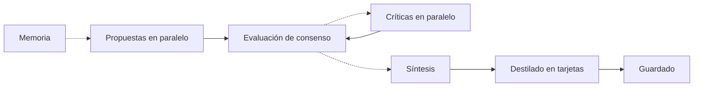

# Manager

Mini cerebro multiagente. Le das un problema, varias LLM gratuitas lo discuten entre sí, y lo que acuerdan queda guardado como conocimiento que después se consulta **sin usar ninguna LLM**.

- **Discusión entre modelos distintos.** Cada agente tiene un rol (analista, crítico, pragmático…) y corre en un proveedor distinto. Proponen, se critican por rondas y un moderador mide el consenso y escribe la síntesis.
- **Vista en vivo.** El grafo de pasos se ilumina mientras corre, cada agente escribe en su carril en streaming, y se ve el consenso ronda por ronda, los acuerdos, los desacuerdos y qué recuperó de la memoria.
- **Memoria con RAG local.** Notas, documentos y síntesis anteriores se recuperan con búsqueda híbrida (vectores + BM25). Los embeddings corren en tu máquina.
- **Módulos consultables sin LLM.** Cada discusión se destila en tarjetas de pregunta y respuesta. Un módulo responde en ~20 ms por recuperación pura, dice cuándo no sabe, y se exporta como una página `.html` autónoma que funciona sin servidor.
- **Integrable.** API REST documentada en `/docs` y servidor MCP para conectarlo a Claude, Cursor u otros agentes.

## Cómo arrancar

Necesitás Python 3.11 o superior. En Windows, doble clic en `iniciar.bat`, o desde una terminal en la carpeta del proyecto:

```bat
.\iniciar.bat
```

La primera vez crea el entorno en `%USERPROFILE%\.manager\venv`, instala las dependencias y descarga el modelo de embeddings (640 MB, una sola vez). Después abre `http://127.0.0.1:8765`.

En Linux o macOS:

```bash
python -m venv .venv && .venv/bin/pip install -r requirements.txt && .venv/bin/python -m manager
```

Sin ninguna API key arranca en **modo demo**: los agentes dan respuestas simuladas para que veas el flujo completo. Para discusiones reales cargá al menos una key gratuita en **Agentes → Proveedores de LLM** (o en un archivo `.env`, ver `.env.example`).

## Proveedores

Todos se usan por su API compatible con OpenAI, así que agregar otro es sumar una entrada en [`proveedores.json`](proveedores.json).

| Proveedor | Dónde sacar la key | Nota |
|---|---|---|
| Groq | console.groq.com/keys | Muy rápido |
| Google Gemini | aistudio.google.com/apikey | Modelos Flash gratis; en el plan gratuito Google puede usar los prompts |
| OpenRouter | openrouter.ai/keys | Una key, muchos modelos `:free` |
| Cerebras | cloud.cerebras.ai | Revisá si tu cuenta tiene plan gratuito |
| Mistral | console.mistral.ai | Revisá las condiciones actuales |
| NVIDIA NIM | build.nvidia.com | Catálogo grande de modelos abiertos |
| Ollama | ollama.com/download | Local: sin key, sin cuotas, nada sale de tu máquina |

Los modelos gratuitos cambian todo el tiempo, por eso **no hay ningún nombre de modelo fijo en el código**: Manager le pide a cada proveedor su lista real y elige según las preferencias de `proveedores.json`. Con una sola key igual discuten modelos distintos, porque reparte un modelo diferente a cada agente. Si un modelo devuelve un límite de uso, reintenta y después pasa a un respaldo.

Los límites y condiciones de los planes gratuitos los define cada proveedor y cambian seguido; verificalos en su sitio.

## Cómo funciona una discusión

El flujo es un grafo de [LangGraph](https://github.com/langchain-ai/langgraph):



1. **Memoria:** busca lo relevante en notas, síntesis previas y módulos.
2. **Propuestas:** cada agente responde por separado, en paralelo.
3. **Evaluación:** el moderador puntúa el consenso de 0 a 1 y lista acuerdos y desacuerdos. Aparte se calcula la similitud entre posturas con embeddings locales.
4. **Críticas:** si no hay consenso y quedan rondas, cada agente lee a los demás, los critica y actualiza su postura. Vuelve al paso 3.
5. **Síntesis:** el moderador escribe la respuesta acordada y lo que sigue en disputa.
6. **Destilado:** la síntesis se convierte en tarjetas autocontenidas, con variantes de la pregunta.
7. **Guardado:** la síntesis entra a la memoria. Las tarjetas las revisás y guardás en un módulo.

## Consultar sin LLM

Un módulo no genera texto: recupera. Por eso las tarjetas se redactan durante la discusión para entenderse solas.

- Cada tarjeta guarda varios vectores (la pregunta, cada variante y la respuesta) y se puntúa por el más cercano. Eso la hace robusta a preguntas hechas con otras palabras.
- La búsqueda combina vectores y BM25 con *Reciprocal Rank Fusion*.
- La respuesta trae un nivel de confianza: **alta**, **media** (coincidencia parcial, conviene verificar) o **ninguna**, en cuyo caso ofrece abrir una discusión.
- Si tenés Ollama abierto, podés pedir que un modelo local redacte la respuesta a partir de las tarjetas.

El modelo de embeddings por defecto es `jina-embeddings-v2-base-es` (español e inglés). En una prueba con 16 preguntas parafraseadas y 10 ajenas sobre 12 tarjetas acertó 15 de 16 y separó bien las ajenas. Para un modelo más liviano (220 MB, ~50 idiomas, menos preciso) poné `MANAGER_EMBED_MODEL=sentence-transformers/paraphrase-multilingual-MiniLM-L12-v2`.

Límite real: un módulo responde lo que está cubierto por sus tarjetas. No razona sobre casos nuevos; para eso está la discusión.

## Integración

**API REST.** Documentación interactiva en `http://127.0.0.1:8765/docs`. Lo principal:

```bash
curl -X POST http://127.0.0.1:8765/api/ask -H "Content-Type: application/json" -d "{\"q\": \"cada cuanto se hacen los backups\"}"
```

`POST /api/discussions` abre una discusión y `GET /api/discussions/{id}/events` transmite sus eventos por SSE.

**MCP.** `python -m manager --mcp` expone las herramientas `consultar`, `buscar_memoria`, `listar_modulos`, `guardar_conocimiento`, `agregar_nota` y `discutir`. Ejemplo de configuración para un cliente MCP en Windows:

```json
{
  "mcpServers": {
    "manager": {
      "command": "C:\\Users\\TU_USUARIO\\.manager\\venv\\Scripts\\python.exe",
      "args": ["-m", "manager", "--mcp"],
      "cwd": "C:\\ruta\\a\\Manager"
    }
  }
}
```

## Estructura

```
manager/
  llm.py          cliente único para APIs compatibles con OpenAI, reintentos y demo
  debate.py       grafo de LangGraph y eventos en vivo
  store.py        memoria, módulos, búsqueda híbrida y exportación
  embeddings.py   embeddings locales (fastembed / ONNX)
  db.py           SQLite: texto, vectores e índice BM25 en un solo archivo
  api.py          API REST y SSE (FastAPI)
  mcp_server.py   servidor MCP
web/              interfaz, sin paso de compilación
proveedores.json  catálogo de proveedores
data/             tu base y tus keys (no se sube a git)
```

## Estado de las pruebas

Probado de punta a punta en modo demo, y el camino de llamadas reales (streaming, reintento tras 429, respaldo en otro proveedor, modelos inexistentes, keys inválidas) contra un servidor falso compatible con OpenAI. **No está probado contra las APIs reales de cada proveedor**, porque requiere keys: usá el botón **Probar** de cada proveedor al cargar la tuya.
