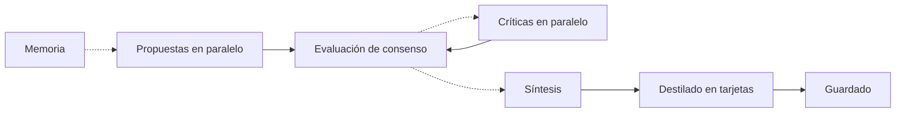

# Manager

Mini cerebro multiagente. Le das un problema, varias LLM gratuitas lo discuten entre sí, y lo que acuerdan queda guardado como conocimiento que después se consulta **sin usar ninguna LLM**.

- **Discusión entre modelos distintos.** Cada agente tiene un rol (analista, crítico, pragmático…) y corre en un proveedor distinto. Proponen, se critican por rondas y un moderador mide el consenso y escribe la síntesis.
- **Vista en vivo.** El grafo de pasos se ilumina mientras corre, cada agente escribe en su carril en streaming, y se ve el consenso ronda por ronda, los acuerdos, los desacuerdos y qué recuperó de la memoria.
- **Memoria con RAG local.** Notas, documentos y síntesis anteriores se recuperan con búsqueda híbrida (vectores + BM25). Los embeddings corren en tu máquina.
- **Módulos consultables sin LLM.** Cada discusión se destila en tarjetas de pregunta y respuesta. Un módulo responde en ~20 ms por recuperación pura, dice cuándo no sabe, y se exporta como una página `.html` autónoma que funciona sin servidor.
- **Integrable.** API REST documentada en `/docs` y servidor MCP para conectarlo a Claude, Cursor u otros agentes.

## Cómo arrancar

Necesitás Python 3.11 o superior. En Windows, doble clic en `iniciar.bat`, o desde una terminal en la carpeta del proyecto:

```bat
.\iniciar.bat
```

La primera vez crea el entorno en `%USERPROFILE%\.manager\venv`, instala las dependencias y descarga el modelo de embeddings (640 MB, una sola vez). Después abre `http://127.0.0.1:8765`.

En Linux o macOS:

```bash
python -m venv .venv && .venv/bin/pip install -r requirements.txt && .venv/bin/python -m manager
```

Sin ninguna API key arranca en **modo demo**: los agentes dan respuestas simuladas para que veas el flujo completo. Para discusiones reales cargá al menos una key gratuita en **Agentes → Proveedores de LLM** (o en un archivo `.env`, ver `.env.example`).

## Proveedores

Todos se usan por su API compatible con OpenAI, así que agregar otro es sumar una entrada en [`proveedores.json`](proveedores.json). El catálogo sale del directorio [itsfree.ai](https://itsfree.ai/) y de pruebas propias del 13 de noviembre de 2026.

| Qué pide | Proveedores |
|---|---|
| **Nada: se activan con un clic** | OVHcloud AI Endpoints (2 pedidos por minuto por modelo), LLM7.io (10 por minuto) |
| Email, sin tarjeta | Groq, Google AI Studio (Gemini), OpenRouter, Mistral, Cohere, Requesty, OpenCode Zen, Vercel AI Gateway, Ollama Cloud, Cloudflare Workers AI, Z.ai, AMD Radeon Cloud, SambaNova |
| Teléfono verificado | NVIDIA NIM |
| Nada, corren en tu máquina | Ollama, LM Studio, llama.cpp, Jan |

Para empezar sin registrarte en nada: **Agentes → Proveedores → OVHcloud → Activar sin key**. Discuten gpt-oss, Llama 3.3 y Mistral, y una discusión de prueba tardó 75 segundos. Tené en cuenta que con cualquier proveedor en la nube tus prompts llegan a ese servicio; para algo confidencial usá uno local.

Los planes gratuitos cambian todas las semanas, por eso **no hay ningún nombre de modelo fijo en el código**:

- Manager le pide a cada proveedor su lista real y descarta lo que no conversa (audio, imagen, embeddings, clasificadores).
- Reparte un modelo de **familia distinta** a cada agente, así debaten LLM diferentes aun con una sola key.
- Si un modelo no existe, no está incluido en tu plan o se quedó sin cupo, lo **saca de rotación un rato**, el agente pasa a otro y sigue.
- Respeta los cupos por minuto esperando en vez de fallar, y la interfaz muestra la espera.

No están en el catálogo los que piden tarjeta (Cerebras, Nebius), los que solo dan un crédito inicial (DeepSeek, Nscale, AI21) y los que exigen un teléfono de China (ModelScope, SiliconFlow).

## Cómo funciona una discusión

El flujo es un grafo de [LangGraph](https://github.com/langchain-ai/langgraph):



1. **Memoria:** busca lo relevante en notas, síntesis previas y módulos.
2. **Propuestas:** cada agente responde por separado, en paralelo.
3. **Evaluación:** el moderador puntúa el consenso de 0 a 1 y lista acuerdos y desacuerdos. Aparte se calcula la similitud entre posturas con embeddings locales.
4. **Críticas:** si no hay consenso y quedan rondas, cada agente lee a los demás, los critica y actualiza su postura. Vuelve al paso 3.
5. **Síntesis:** el moderador escribe la respuesta acordada y lo que sigue en disputa.
6. **Destilado:** la síntesis se convierte en tarjetas autocontenidas, con variantes de la pregunta.
7. **Guardado:** la síntesis entra a la memoria. Las tarjetas las revisás y guardás en un módulo.

## Consultar sin LLM

Un módulo no genera texto: recupera. Por eso las tarjetas se redactan durante la discusión para entenderse solas.

- Cada tarjeta guarda varios vectores (la pregunta, cada variante y la respuesta) y se puntúa por el más cercano. Eso la hace robusta a preguntas hechas con otras palabras.
- La búsqueda combina vectores y BM25 con *Reciprocal Rank Fusion*.
- La respuesta trae un nivel de confianza: **alta**, **media** (coincidencia parcial, conviene verificar) o **ninguna**, en cuyo caso ofrece abrir una discusión.
- Si tenés Ollama abierto, podés pedir que un modelo local redacte la respuesta a partir de las tarjetas.

El modelo de embeddings por defecto es `jina-embeddings-v2-base-es` (español e inglés). En una prueba con 16 preguntas parafraseadas y 10 ajenas sobre 12 tarjetas acertó 15 de 16 y separó bien las ajenas. Para un modelo más liviano (220 MB, ~50 idiomas, menos preciso) poné `MANAGER_EMBED_MODEL=sentence-transformers/paraphrase-multilingual-MiniLM-L12-v2`.

Límite real: un módulo responde lo que está cubierto por sus tarjetas. No razona sobre casos nuevos; para eso está la discusión.

## Módulos de ejemplo

En [`semillas/`](semillas/) hay 8 módulos de metodología de bug bounty **autorizado** (scope, IDOR/BOLA, SSRF, inyección, XSS, autenticación, GraphQL/APIs y reporte), 55 tarjetas que consultás sin LLM: dónde mirar y cómo confirmar cada clase de falla, siempre dentro del alcance del programa.

Cargalos desde la interfaz (**Módulos → Importar módulo**, un `.json` por vez) o todos de una:

```bash
python semillas/generar.py --cargar http://127.0.0.1:8765
```

Son un punto de partida editable: agregá tus propias tarjetas y hallazgos desde la interfaz. El generador ([`semillas/generar.py`](semillas/generar.py)) tiene el contenido en texto plano, fácil de ampliar.

## Integración

**API REST.** Documentación interactiva en `http://127.0.0.1:8765/docs`. Lo principal:

```bash
curl -X POST http://127.0.0.1:8765/api/ask -H "Content-Type: application/json" -d "{\"q\": \"cada cuanto se hacen los backups\"}"
```

`POST /api/discussions` abre una discusión y `GET /api/discussions/{id}/events` transmite sus eventos por SSE.

**MCP.** `python -m manager --mcp` expone las herramientas `consultar`, `buscar_memoria`, `listar_modulos`, `guardar_conocimiento`, `agregar_nota` y `discutir`. Ejemplo de configuración para un cliente MCP en Windows:

```json
{
  "mcpServers": {
    "manager": {
      "command": "C:\\Users\\TU_USUARIO\\.manager\\venv\\Scripts\\python.exe",
      "args": ["-m", "manager", "--mcp"],
      "cwd": "C:\\ruta\\a\\Manager"
    }
  }
}
```

## Estructura

```
manager/
  llm.py          cliente único para APIs compatibles con OpenAI, reintentos y demo
  debate.py       grafo de LangGraph y eventos en vivo
  store.py        memoria, módulos, búsqueda híbrida y exportación
  embeddings.py   embeddings locales (fastembed / ONNX)
  db.py           SQLite: texto, vectores e índice BM25 en un solo archivo
  api.py          API REST y SSE (FastAPI)
  mcp_server.py   servidor MCP
web/              interfaz, sin paso de compilación
proveedores.json  catálogo de proveedores
data/             tu base y tus keys (no se sube a git)
```

## Seguridad

Manager no tiene login: está pensado para correr en tu máquina. Por eso solo escucha en `127.0.0.1` y rechaza los pedidos que vengan de otra página web o con otro nombre de host, para que un sitio que visites no pueda abrir discusiones ni pisar tus keys. Si lo arrancás con `--host 0.0.0.0`, cualquiera en tu red puede usarlo.

## Pruebas

```bash
python tests/prueba_motor.py
python tests/prueba_proveedores.py
```

La primera recorre memoria, módulos, consulta sin LLM, exportación y una discusión completa en modo demo. La segunda ejercita las llamadas reales (streaming, reintentos, respaldos, modelos caídos, acceso sin key, cupos) contra un servidor falso, sin internet.

Qué está verificado contra servicios reales, al 13 de noviembre de 2026:

- **OVHcloud sin key:** una discusión completa de punta a punta.
- **Los demás proveedores en la nube:** que la URL existe y rechaza una key inválida como se espera. **Ninguno está probado con una key real**; usá el botón **Probar** al cargar la tuya.
- **Los locales** (Ollama, LM Studio, llama.cpp, Jan): sin probar, no estaban instalados.
